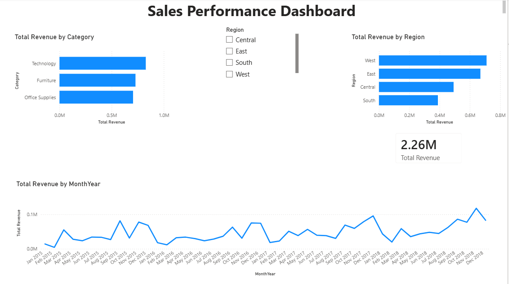

# Sales Performance Dashboard

An interactive Sales Performance Dashboard built in Power BI on the Superstore sales dataset. It connects and transforms raw sales data, models a date table, and visualizes revenue trends, regional performance, and category breakdowns.



## Objective

Build an interactive dashboard to compare revenue across regions and product categories and to track sales trends over time.

## Tools Used

- **Power BI Desktop**: report building and visualization
- **Power Query**: data import and transformation
- **DAX**: calculated measures and a custom date table

## Dataset

- **Source:** Superstore Sales Dataset (9,800 order lines across 4,922 orders, Jan 2015 – Dec 2018)
- **Fields used:** Order Date, Region, Category, Sub-Category, Sales

## Data Preparation

- Imported the raw CSV via Power Query and validated column data types (Order Date as Date, Sales as Decimal Number)
- Built a dedicated **Date table** with `CALENDAR()`, marked as the date table, and related it to the sales table
- Added a `MonthYear` column with a numeric sort-order column so the monthly trend displays in chronological order

## DAX Measures

```DAX
Total Revenue = SUM(train[Sales])
```

## Dashboard Features

- **KPI Card:** Total Revenue
- **Bar Charts:** Revenue by Region, Revenue by Product Category
- **Trend Line:** Total Revenue by Month, 2015–2018
- **Slicer:** Region filter that updates all visuals

## Key Insights

- Total sales were **2.26M** across the dataset.
- The **West (0.71M)** and **East (0.67M)** regions lead; the South is lowest (0.39M).
- **Technology** is the top category (0.83M), but the three categories are close (Furniture 0.73M, Office Supplies 0.71M).
- Sales are seasonal: September–December accounts for roughly 50–54% of each year's sales, and the highest single month is November 2018.

## Repo Structure

```
sales-performance-dashboard/
├── README.md
└── screenshots/
    └── dashboard_overview.png
```
